# ETL_ELT_process_parcel_dataset
# NC Property Parcels — Medallion Architecture ELT/ETL Project

An end-to-end data engineering project built around Wake County, NC property parcel
records. The same source dataset is processed twice, using two different tools, to
practice the medallion (Bronze → Silver → Gold) pattern in both a cloud lakehouse and
a traditional ETL tool:

1. **Databricks** — ELT pipeline using PySpark + SQL notebooks, Unity Catalog volumes,
   Delta tables, incremental/watermark loading, a multi-task Databricks Job, and
   dashboards built on top of the Gold layer.
2. **Pentaho Data Integration (Spoon/Kettle)** — the same Bronze → Silver → Gold logic
   rebuilt visually as PDI transformations and orchestrated with a job.

> **Folder layout:** this README expects four subfolders sitting next to it —
> `databricks/` (Databricks Job graph screenshot), `dashboards/` (the six chart
> screenshots), `pentaho_spoon/` (the four Pentaho canvas/job screenshots), and
> `table/` (data previews for each Bronze/Silver/Gold table) —
> each holding the image with the filename referenced below it.

---

## 1. Dataset

- **Source:** [data.gov](https://www.data.gov/) — Wake County, NC property/parcel
  (real estate assessment) records, published as `Property.csv`.
- **Grain:** one row per parcel, keyed by `PARCEL_PK`.
- **Size:** 437,523 rows × 59 source columns.
- **Notable fields:** `OWNER`, `SITE_ADDRESS` / `FULL_STREET_NAME`, `CITY` /
  `CITY_DECODE`, `TOWNSHIP` / `TOWNSHIP_DECODE`, `YEAR_BUILT`, `HEATEDAREA`,
  `DEED_ACRES`, `BLDG_VAL`, `LAND_VAL`, `TOTAL_VALUE_ASSD`, `TOTSALPRICE` /
  `SALE_DATE`, `TYPE_AND_USE` / `TYPE_USE_DECODE`, `DESIGNSTYL` /
  `DESIGN_STYLE_DECODE`, `LAND_CLASS` / `LAND_CLASS_DECODE`, `BILLCLASS` /
  `BILLING_CLASS_DECODE`, `EXEMPTSTAT`, `OLD_PARCEL_NUMBER`.
- Many attributes ship as a **code + decode pair** (e.g. `LAND_CLASS` /
  `LAND_CLASS_DECODE`), which is what drives the dimension tables in the Gold layer.

---

## 2. Databricks — Medallion ELT Pipeline

**Catalog:** `parcels_project` &nbsp;|&nbsp; **Schemas:** `bronze`, `silver`, `gold`
**Compute:** Serverless &nbsp;|&nbsp; **Format:** Delta Lake
**Notebooks:** `parcels_bronze`, `parcels_silver`, `parcels_gold` (one per layer)

### Bronze Layer — raw ingestion with incremental loading via Volumes
- Source CSV files land in a Unity Catalog volume:
  `/Volumes/parcels_project/bronze/raw_dataset/`.
- The notebook lists files already loaded (by checking `source_file` values already
  present in `parcels_project.bronze.property_raw`) and compares that against the
  files currently sitting in the volume, so **only new files are read and appended**
  — existing files are skipped on re-run.
- Each new file is read with PySpark (`inferSchema=True`), stamped with two metadata
  columns — `ingest_timestamp` (`current_timestamp()`) and `source_file` (the file
  name) — and appended to the Delta table `parcels_project.bronze.property_raw`.
- Row counts are reconciled after each load: source file row count vs. rows landed in
  Bronze for that `source_file`, flagging any mismatch.
- Data-quality checks (row totals, latest load timestamp, NULL `PARCEL_PK` count) are
  run in SQL at the end of the notebook.

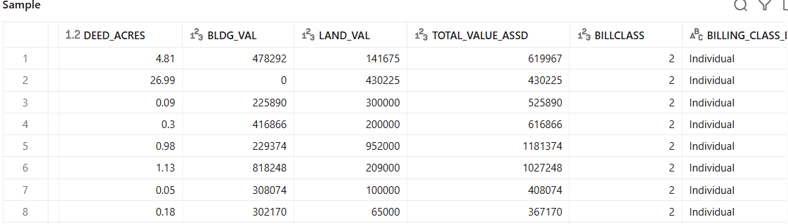

### Silver Layer — cleaning, standardization, enrichment
Built as a chain of temp views inside one notebook so each transformation step can be
validated before the next is applied:

1. **Incremental read** — reads only Bronze rows with `ingest_timestamp` newer than
   the current max `ingest_timestamp` already in
   `parcels_project.silver.property_cleaned` (a watermark pattern), so re-running the
   notebook doesn't reprocess rows already promoted to Silver.
2. **Deduplication** — 119 duplicate `PARCEL_PK` values found in Bronze; resolved with
   `ROW_NUMBER() OVER (PARTITION BY PARCEL_PK ORDER BY ingest_timestamp DESC,
   OBJECTID DESC)`, keeping the most recently ingested row per parcel.
3. **Trim / null cleanup** — blank strings and literal `"null"` text normalized to
   real `NULL`s; `ADDR3`, `STPRE`, `STSUF` dropped as not needed for analysis;
   `OLD_PARCEL_NUMBER` is **kept** (per business requirement, for historical
   reference) but only well-formed values (`###-#####-####`) are retained — partial
   or placeholder values (`--`, `542--`) are nulled out.
4. **PK guard** — rows with a null/blank `PARCEL_PK` are dropped (the table's grain
   key can't be null).
5. **Type casting** — `TRY_CAST`/`TRY_TO_TIMESTAMP` used throughout so a bad value
   becomes `NULL` instead of failing the job (acreage, values, and dates cast to
   `DOUBLE`/`DECIMAL`/`DATE`).
6. **Standardization** — code/decode columns (`CITY_DECODE`, `TOWNSHIP_DECODE`,
   `TYPE_USE_DECODE`, `LAND_CLASS_DECODE`) coalesced to `'UNKNOWN'` where missing; a
   full street address is concatenated from the individual address parts; an
   `IS_TAX_EXEMPT` boolean is derived from `EXEMPTSTAT`.
7. **Derived metrics:**
   - `PROPERTY_AGE_YEARS` = current year − `YEAR_BUILT`
   - `BUILD_ERA` — bucketed into Pre-1950 / 1950-1979 / 1980-1999 / 2000-2009 /
     2010+ / Unknown
   - `ASSESSED_VALUE_PER_SQFT` = `TOTAL_VALUE_ASSD` / `HEATEDAREA`
   - `ASSESSED_VALUE_PER_ACRE` = `TOTAL_VALUE_ASSD` / `DEED_ACRES`
   - A `property_agg_by_city` summary view (property count, total/avg assessed
     value, total heated area, avg value/sqft per city)
8. **Load** — the cleaned, deduped, enriched rows are `MERGE INTO`'d into
   `parcels_project.silver.property_cleaned` (upsert on `PARCEL_PK`), keeping Silver
   as one current row per parcel while staying incremental.

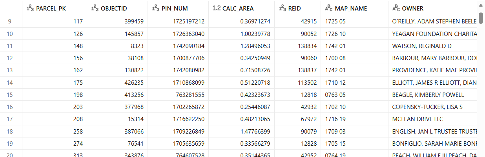

### Gold Layer — star schema (dimensions + fact)
`parcels_project.gold` holds six dimension tables and one fact table, all loaded with
a **surrogate-key pattern**: `COALESCE(MAX(key), 0) + ROW_NUMBER()`, so re-running the
notebook only assigns new keys to genuinely new dimension members instead of
reloading everything.

| Table | Grain / key | Source columns |
|---|---|---|
| `dim_city` | `city_key` | `CITY_DECODE`, `PLANNING_JURISDICTION` |
| `dim_township` | `township_key` | `TOWNSHIP_DECODE`, `FIREDIST` |
| `dim_land_class` | `land_class_key` | `LAND_CLASS`, `LAND_CLASS_DECODE` |
| `dim_property_type` | `property_type_key` | `TYPE_AND_USE`, `TYPE_USE_DECODE` |
| `dim_design_style` | `design_style_key` | `DESIGNSTYL`, `DESIGN_STYLE_DECODE` |
| `dim_billing_class` | `billing_class_key` | `BILLCLASS`, `BILLING_CLASS_DECODE` |
| `fact_property` | one row per `PARCEL_PK` | FKs to all six dimensions + `BUILD_ERA`, `IS_TAX_EXEMPT`, address, owner, `YEAR_BUILT`, `PROPERTY_AGE_YEARS`, `HEATEDAREA`, `DEED_ACRES`, `BLDG_VAL`, `LAND_VAL`, `TOTAL_VALUE_ASSD`, `ASSESSED_VALUE_PER_SQFT`, `ASSESSED_VALUE_PER_ACRE`, `TOTSALPRICE`, `SALE_DATE`, `DEED_DATE` |

`fact_property` is populated with a `MERGE INTO` that joins `silver.property_cleaned`
to each dimension to resolve its surrogate key, keeping the fact table upsertable and
incremental rather than a full rebuild on every run. The notebook finishes with
validation queries — row-count reconciliation between Silver and Gold, a check for
unresolved foreign keys (`city_key IS NULL`), and a check that a specific incremental
batch (`source_file LIKE '%Incremantal_loading_1%'`) landed correctly in the fact
table — proving the incremental load path end-to-end.

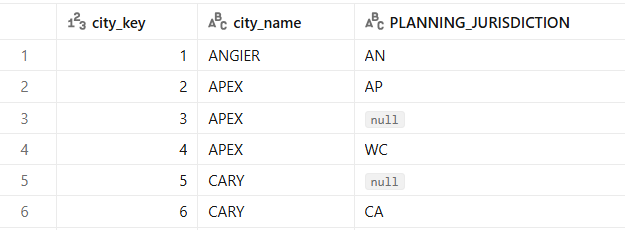
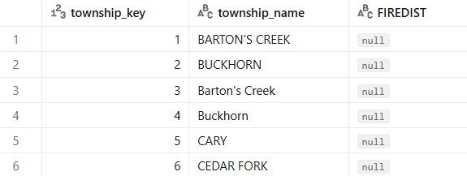
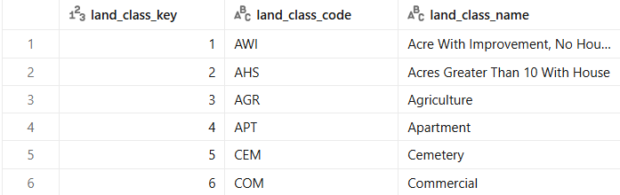
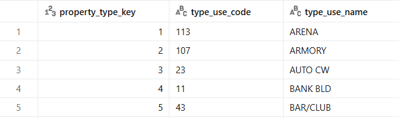
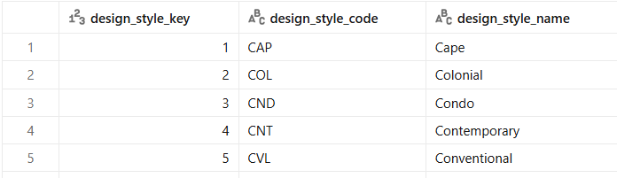
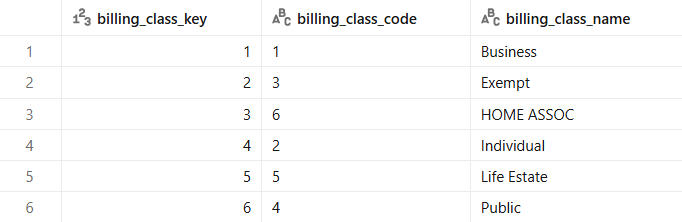
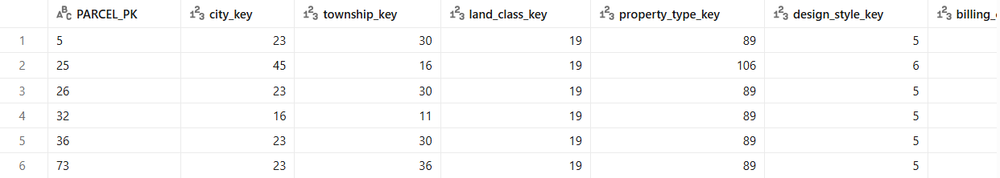

### Orchestration
The three notebooks are wired into a single **Databricks Job** with a linear
dependency graph, `bronze → silver → gold`, run on serverless compute. All three
tasks succeeded on the latest run (Bronze 23s, Silver 1m 33s, Gold 45s), confirming
the full pipeline runs cleanly end to end on a fresh trigger.

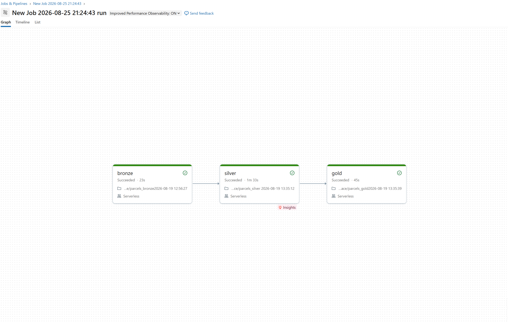

### Dashboards
Built on top of the Gold star schema:

- **Average value per square ft by usage of property** — bar chart of
  `dim_property_type` vs. average `ASSESSED_VALUE_PER_SQFT`; property types like
  GAS ONLY, DI BANK, and RESTROOM carry the highest per-sqft value. These niche,
  non-residential use codes sit on small footprints with high-value improvements,
  so their per-square-foot number dwarfs ordinary residential property types once
  the two are placed on the same axis.

  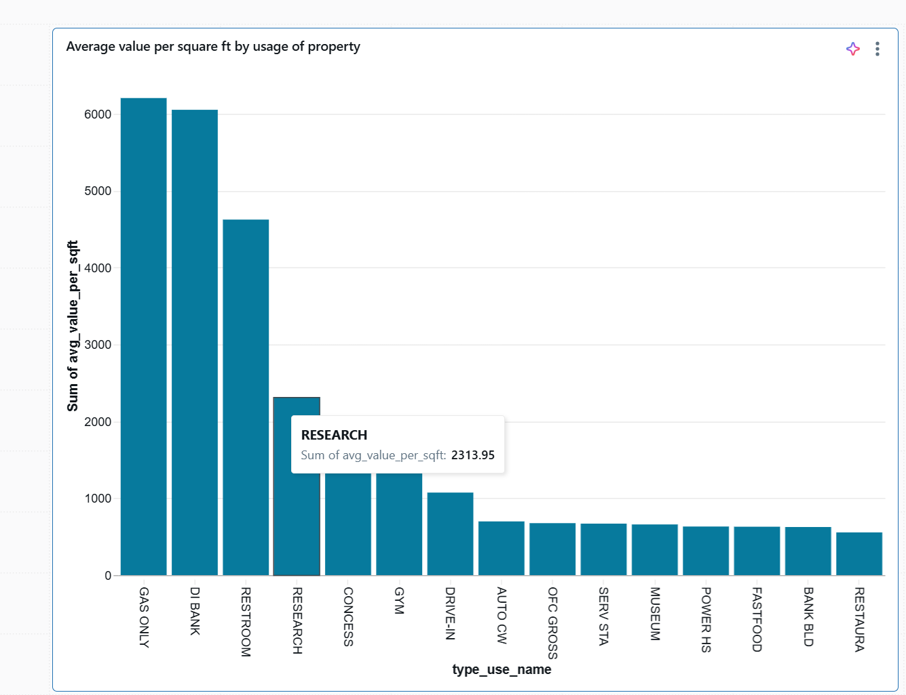

- **Gap: assessed value vs. sale price (all cities)** — the difference between
  assessed value and sale price by `dim_city`, dominated by Raleigh given its share
  of total parcels. Because Raleigh accounts for the largest slice of parcels
  county-wide, its assessed-vs-sale gap carries the most absolute weight even if
  other cities show a larger gap on a per-parcel basis.

  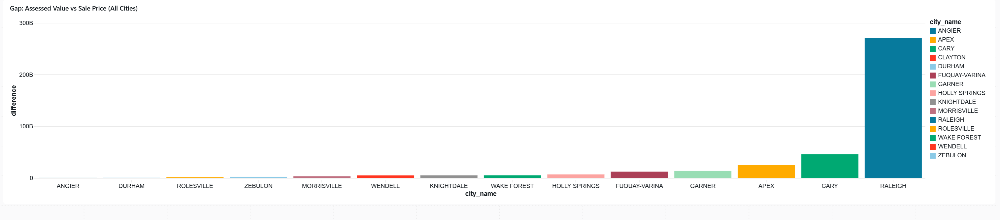

- **Living cost by city** — sum of assessed value by city. Functions as a rough
  proxy for where property wealth is concentrated across Wake County, letting you
  compare total assessed value city-by-city rather than looking at any single
  parcel in isolation.

  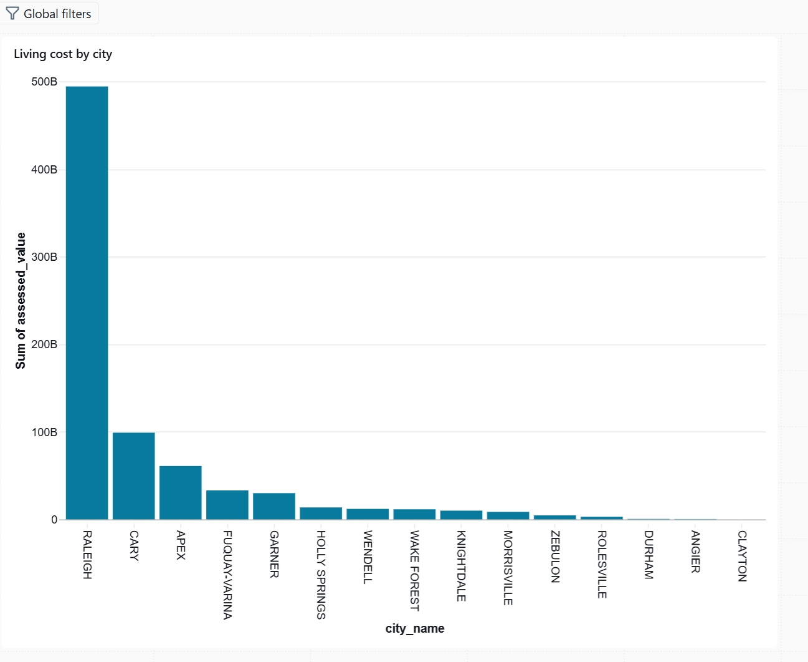

- **Average property value by build year** — donut chart of property count by
  `BUILD_ERA`. Groups every parcel into its construction-era bucket (Pre-1950,
  1950-1979, 1980-1999, 2000-2009, 2010+, Unknown) to show the age composition of
  the county's housing stock at a glance.

  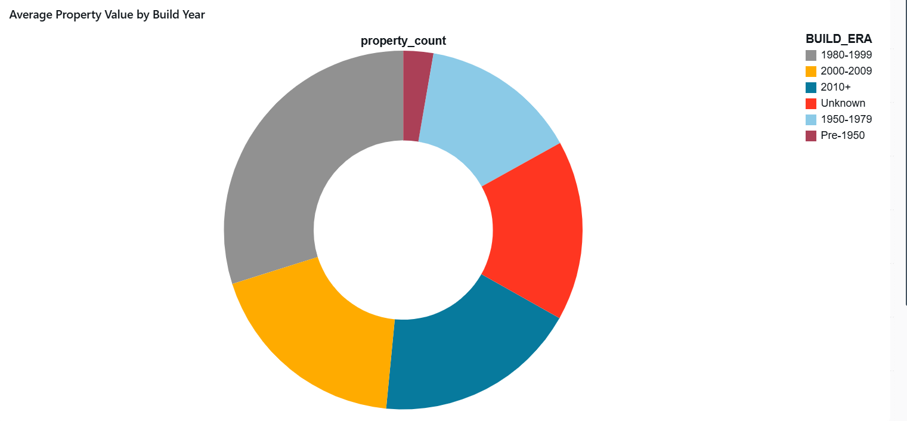

- **Property sales trend over time** — number of sales by `sale_year`, plus headline
  KPIs (2.34M total properties, $1.56T total assessed value). The line tracks how
  sales volume has moved year over year, while the KPI cards give the portfolio-wide
  totals for context alongside the trend.

  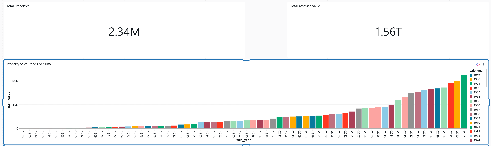

- **Property values over the years** — average `TOTAL_VALUE_ASSD` by
  `PROPERTY_AGE_YEARS`. Plots assessed value against how old a property is, showing
  whether older homes tend to hold, gain, or lose value relative to newer
  construction.

  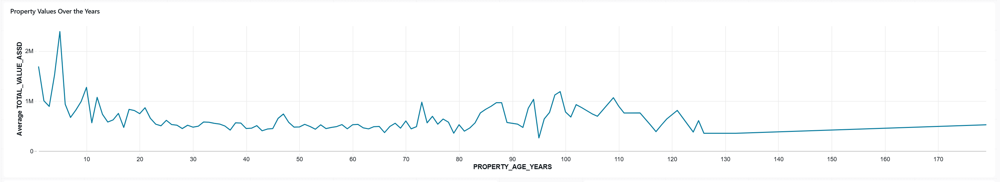

---

## 3. Pentaho Data Integration (Spoon) — ETL Rebuild

The same Bronze → Silver → Gold logic rebuilt visually in **Spoon**, PDI's
transformation designer, as a way to learn the tool. Differences from the Databricks
version: no `ingest_timestamp`/`source_file` metadata columns are added, and all
column drops are deferred to a single **Select values** step at the very end of each
transformation (rather than dropping columns mid-chain), to avoid conflicts with the
**Sort rows** / **Unique rows** steps earlier in the flow.

### Bronze transformation
`CSV file input → Text file output`

Reads the raw `Property.csv` and writes it straight through to a text file output —
the landing/raw copy stage.

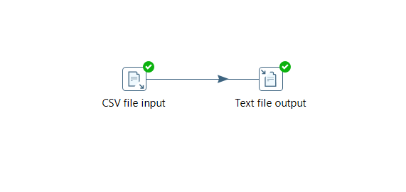

### Silver transformation
```
CSV file input → String operations → Null if → Sort rows → Unique rows →
Regex evaluation → Formula → Null if 2 → Filter rows → Formula 2 →
Select values → Concat fields → Formula 3 → Number range →
Select values 2 → Text file output
```
- **String operations / Null if / Null if 2** — trims and blank/placeholder-to-NULL
  cleanup, mirroring the Silver notebook's trim step.
- **Sort rows → Unique rows** — dedup on the parcel key, equivalent to the
  `ROW_NUMBER()` dedup done in Databricks (ordering has to happen before Unique rows
  in Spoon, which is why sort comes first).
- **Regex evaluation** — validates formatted fields (e.g. `OLD_PARCEL_NUMBER`'s
  `###-#####-####` pattern).
- **Formula / Formula 2** — derived-column calculations (age, per-sqft/per-acre
  values, etc.).
- **Filter rows** — grain guard, equivalent to the "drop rows with null PK" step.
- **Select values** — first pass of column selection/typing.
- **Concat fields** — builds the combined street-address field.
- **Formula 3 / Number range** — bucketing logic, equivalent to the `BUILD_ERA` /
  `PROPERTY_AGE_YEARS` derivations.
- **Select values 2** — final column trim/drop, done last by design so it never
  collides with the Sort/Unique steps upstream.

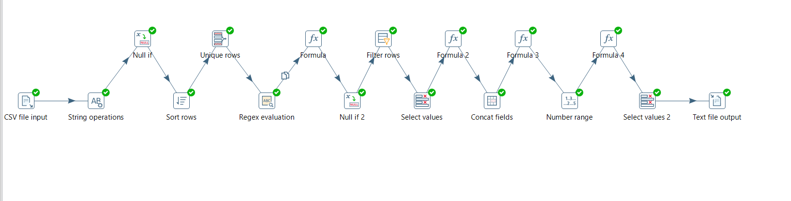

### Gold transformation
```
CSV input_silver → Lookup_city → Lookup_township → Lookup_land_class →
Lookup_property_type → Lookup_design_style → Lookup_billing_class →
Text file output
```
Each **Lookup_*** step joins the cleaned Silver output against its own dimension CSV
(`dim_city`, `dim_township`, `dim_land_class`, `dim_property_type`,
`dim_design_style`, `dim_billing_class`) to resolve surrogate keys, chaining through
all six dimensions before writing the enriched fact rows out — the visual-ETL
equivalent of the `MERGE INTO fact_property` step in the Databricks notebook.

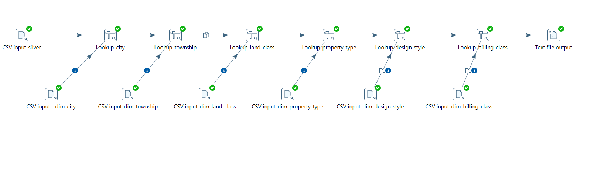

### Job orchestration
A Spoon **Job** ties the three transformations together:
`Start → bronze → silver → (fan-out to) dim_city, dim_design, dim_land, dim_township,
dim_property, dim_billing, fact_property`

All steps completed successfully on the latest run, confirming the Bronze → Silver →
Gold flow (dimensions + fact) executes cleanly end to end in Pentaho, matching the
Databricks pipeline's output.

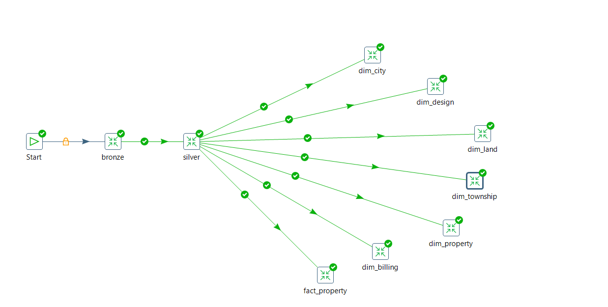

---

## 4. Repo Contents

| File / folder | Description |
|---|---|
| `Property.csv` | Raw source dataset (437,523 rows × 59 columns) |
| `parcels_bronze*.ipynb` | Databricks Bronze layer notebook |
| `parcels_silver*.ipynb` | Databricks Silver layer notebook |
| `parcels_gold*.ipynb` | Databricks Gold layer notebook |
| `databricks/ETLpipelineDataBricks.png` | Databricks Job graph (bronze → silver → gold) |
| `pentaho_spoon/Bronze_Layer.png`, `Silver_Layer.png`, `Gold_Layer.png` | Pentaho Spoon transformation canvases |
| `pentaho_spoon/Finale_pipeline.png` | Pentaho end-to-end job graph |
| `dashboards/*.png` | Gold-layer dashboard chart visuals |
| `table/Bronze_table.png`, `silver_table.png` | Data previews of the Bronze and Silver layer tables |
| `table/dim_city_table.png`, `dim_township_table.png`, `dim_land_table.png`, `dim_property_table.png`, `dim_design_table.png`, `dim_billing_table.png`, `dim_fact_table.png` | Data previews of all six Gold dimension tables and the Gold fact table |
